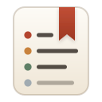
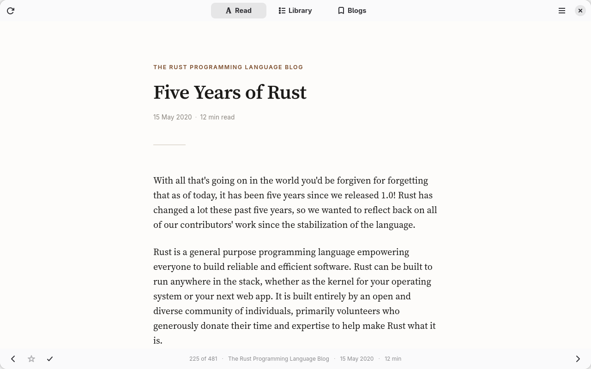
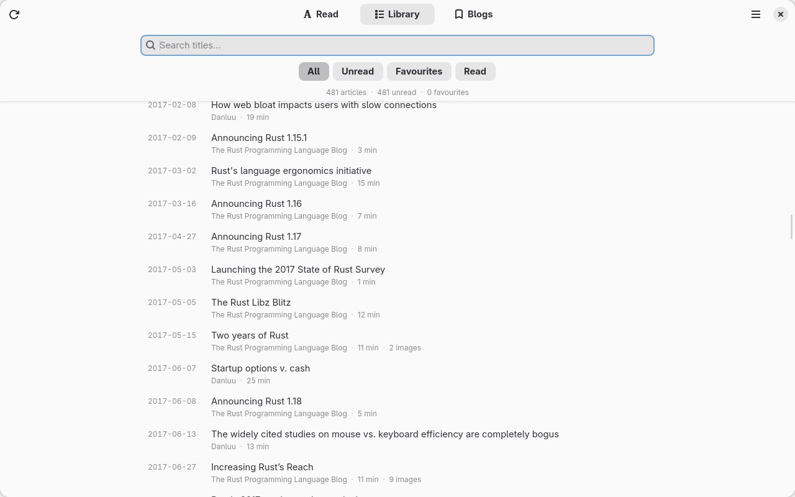
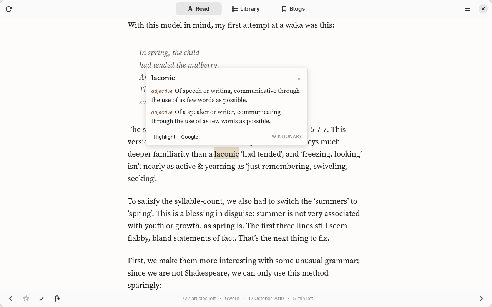

<div align="center">
  
  <h1>Chronicle</h1>
  <p><strong>Read the blogs you follow in one queue, oldest first.</strong></p>
</div>

---

Add the blogs you read. Chronicle goes back and collects everything they have
ever published, then puts it all in a single list ordered by when it was
written — no matter which blog it came from.

```
2004-03   Blog A     An early post
2004-07   Blog C     Something from the same summer
2005-01   Blog B     …
2005-02   Blog A     …
```

So you can start at the beginning and just keep reading.

<div align="center">
  
</div>

## Why not just use a feed reader

A feed reader shows you what's new. Chronicle goes and gets what came before.

Most RSS feeds only list the last handful of posts, so a feed reader can never
show you a blog's back catalogue. Chronicle works through every route a blog
offers — its own API where one exists, otherwise its feed, its sitemaps and
its archive pages combined — and merges what they know: the sitemap's
completeness with the feed's exact dates and full text, and the dates a
blog's own index prints beside each post.

It also gets the dates right, which matters when the whole point is reading in
order:

- It uses the **original** publication date, never the day it found the article.
- Where a blog only says "February 2002", it shows *February 2002* rather than
  inventing a day.
- Where a date is a genuine guess, it says *circa* and tells you why.
- Where there's no date to be had, the article goes in an **Undated** list
  instead of being dropped somewhere wrong in your queue.

## Install

```sh
flatpak install flathub io.github.mvinhas.Chronicle
```

Then open **Blogs**, paste in a blog address, and press **Full archive scan**.

The first run takes a while — it's fetching a blog's entire history, and it
goes slowly on purpose so as not to hammer anyone's website. After that,
**Fetch new posts** picks up only what's appeared since, which takes seconds.

<div align="center">
  
</div>

## Reading

Open it, and you're on the next article. Read it, press `→`, read the next one.
It remembers where you got to.

Prefer to start from the latest post and work backwards? Press `B` (or choose
**Read newest first** in the menu). Next then means the next-older article, the
library lists newest first, and undated articles stay at the end either way.
If you have no place saved, you start at the newest unread article; otherwise
you stay where you were. The choice is remembered.

| | |
|---|---|
| `→` `N` `J` | next article |
| `←` `P` `K` | previous article |
| `Space` | scroll a page |
| `↑` `↓` | scroll a few lines |
| `Home` `End` | start / end of the article |
| `F` | favourite |
| `R` | mark read / unread |
| `S` | skip, and go to the next |
| `L` / `Esc` | back to the list |
| `Ctrl+F` | search |
| `Ctrl+T` | light / dark theme |
| `B` | read newest first / oldest first |
| `H` | hide / show read articles |
| `F5` | fetch new posts |
| `Shift+F5` | full archive scan |

The page glides rather than jumps, and it scrolls itself rather than leaving
it to the browser engine underneath — the wheel, the arrow keys and the space
bar all move with the same motion, and every frame of it lands on a whole
screen pixel. That last part is what keeps the text sharp: a high-resolution
wheel reports fractions of a pixel, and an article left sitting half a pixel
off the grid it was drawn on gets resampled instead of redrawn, which reads as
text going faintly soft until you scroll again. A page turn moves by a whole
number of lines and leaves two behind, so you come down on a line you have
already read.

Articles are stored on your machine, images included, so everything keeps
working offline.

## Look a word up without leaving the page

Select a word and press **Define**. The entry comes to the article — the
senses, the part of speech, an example — the way an e-reader does it, instead
of a browser tab you then have to find your way back from.

<div align="center">
  
</div>

Definitions come from Wiktionary, and once fetched they're kept in your
library. So a word you've looked up stays defined with the network off — the
same bargain the articles themselves are stored under, and the reason this
belongs in the reader rather than in a search engine.

Define is offered for a single word only; no dictionary has an entry for a
sentence. For anything longer there's **Google**, which is the one thing here
that opens your browser.

## Notes and highlights

The same popup offers **Highlight**, and the dictionary card goes on offering
it too, so looking a word up doesn't cost you the passage you'd marked out.
Click a highlight to attach a note to it. There's also a note box at the foot
of every article for anything you want to say about the piece as a whole.

Highlights are anchored to the words themselves rather than to a position in
the file, so they stay put when a blog edits a post or Chronicle re-fetches it.
If the text a highlight marked really does disappear, the highlight is kept and
listed as no longer present rather than quietly thrown away.

While the note box has focus the single-key reading shortcuts stand down, so
you can type freely; `Esc` leaves the box and saves what you wrote.

The library has a **Notes** filter listing everything you annotated, with what
you wrote shown under each article, and a **Highlights** filter listing just
the passages you marked.

All of it stays on your machine, and an archive update never overwrites it.

## Skipping what you don't want

Not everything a blog publishes is for you. Press `S` and Chronicle passes the
article over and moves you to the next one — it leaves the queue rather than
counting as read, so the two never get confused. There's an **Undo** on the
way out if you change your mind, and a **Skipped** filter in the library that
lists them all and puts any of them back.

The **Blogs** tab then shows what proportion of each blog you have skipped:

```
Peter Attia MD    412 readable  ·  2018–2026  ·  62% skipped
Wait But Why      184 readable  ·  2013–2026  ·  4% skipped
```

Which is the useful part — it tells you, from your own reading rather than a
guess, which blogs are earning their place in the queue.

## Reading a book

Chronicle can read a book you own as well as blogs. In the **Blogs** tab press
the **Add book…** button and choose an `.epub` file (or run `chronicle add-book
PATH.epub [--name NAME]`). The book is read from your disk, offline: you
supply the file, and nothing is downloaded from any website.

- It works with any **DRM-free** EPUB. DRM-protected EPUBs are not supported,
  and Chronicle does not remove DRM.
- Each chapter becomes an article, in the book's own order, titled from its
  table of contents. A book whose contents point to places inside a few big
  files (Project Gutenberg's do) is cut at those places. Cover, title page,
  copyright and contents pages are skipped; short pages are judged by what
  they say as well as what they are called, so a real chapter that happens to
  be named "Contents" stays. Images are kept; MathML equations are turned
  into plain text with superscripts and subscripts (`E = mc`<sup>2</sup>);
  links between chapters become plain text.
- Chapters have no dates, so they sit after your dated posts, always in order
  from the first chapter to the last, in either reading direction. Two books
  never interleave. Read state, notes and highlights work as for any article.
- Adding a book copies it into Chronicle's own library folder (`books/` under
  the data directory), so it keeps working if you move or delete the original
  and under Flatpak, where the file chooser hands over a temporary path. The
  book is identified by the path you chose: adding the same path again says
  it is already in your library. Pressing **Fetch new posts** or **Full
  archive scan** on a book is cheap: the original is re-read only if its
  content changed, and then the chapters are updated in place, keeping read
  state, notes and highlights. If the new edition renames its internal files
  (EPUB 2 to EPUB 3, say), chapters are matched to the old ones by title and
  your state moves across; a chapter that cannot be matched is removed only if
  you never read, annotated or favourited it. A changed original that cannot
  be read leaves the stored copy in use. If the original has gone the update
  says it used the stored copy. Books are matched by title, so a new edition
  that retitles every chapter starts those chapters afresh. A book added while
  another update is running is imported when that update finishes.
- The file is treated as untrusted: it is read in memory with size limits,
  scripts are never run and external references are never followed.

## Keeping up to date

Chronicle catches up by itself. A few seconds after you open it — once the
window is up, never before — it looks for new posts in the background, and
says nothing unless it finds some. It doesn't ask every blog every time: it
knows how often each one actually publishes, and asks a daily blog several
times a day and a monthly one every few days. On a typical launch that's one
blog, not all of them. Nothing goes unasked for more than three days.

The buttons are still there for when you want to be sure:

- **Fetch new posts** — what each blog has published since the last update, in
  seconds. How that is done depends on what the site offers: an API is simply
  asked for posts published since your newest one; a feed or archive index is
  read newest-first and abandoned as soon as it reaches what you already have;
  and a site with neither — gwern.net has no feed, and its sitemap carries no
  dates at all — is enumerated by which of its pages you do not yet hold. This
  is `F5`, and what you want almost every time.
- **Full archive scan** — re-examines each blog's whole history. Slow. Use it
  after adding a blog, or to fill in gaps.

## A blog isn't working properly?

Some sites need special handling, and Chronicle ships a few purpose-built
adapters for ones that do. If a blog you read comes out with missing posts or
wrong dates,
[open an issue](https://github.com/MVinhas/chronicle/issues/new?labels=adapter-request)
with the address and what looks wrong.

Pasting an address with a path (`fs.blog/blog/`) no longer hides a site's own
API: Chronicle checks the site root for WordPress or Ghost first. Works in
Progress ships as a built-in recipe.

## Building it yourself

```sh
git clone https://github.com/MVinhas/chronicle
cd chronicle
./build-flatpak.sh
```

Needs Flatpak and the GNOME 50 runtime. There's a command-line interface too,
and notes on how it all fits together, in [CONTRIBUTING.md](CONTRIBUTING.md).

## Licence

[GPL-3.0-or-later](LICENSE). The reading typeface is
[Source Serif 4](https://github.com/adobe-fonts/source-serif), under the SIL
Open Font License.
